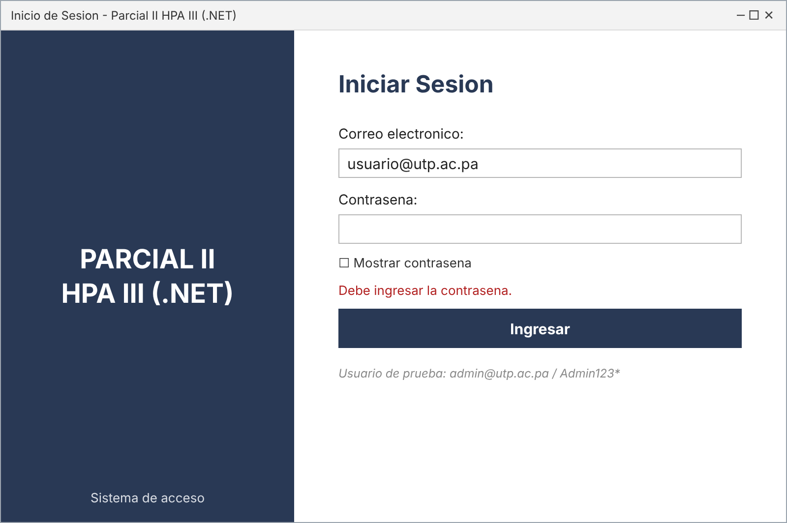
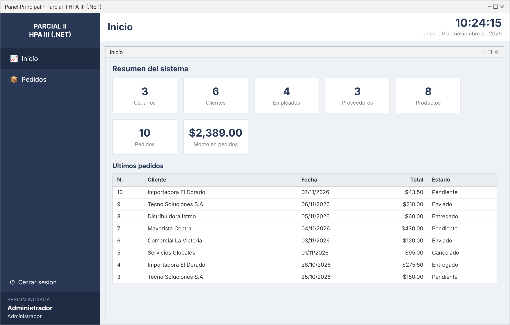
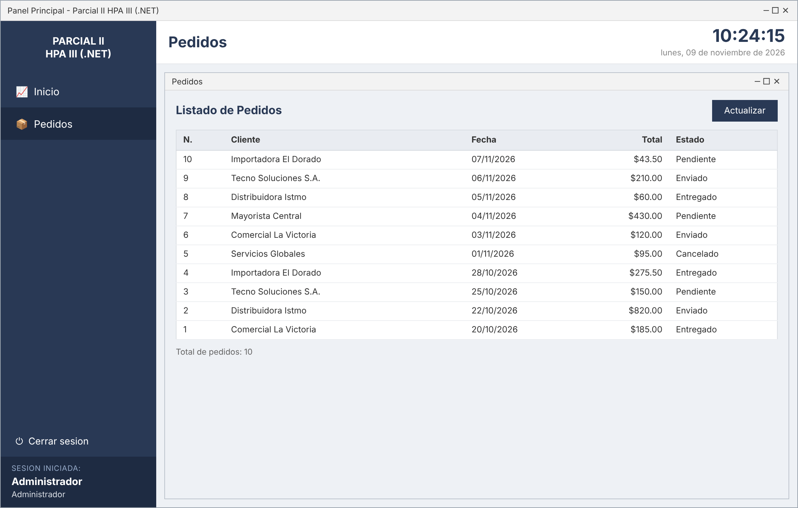
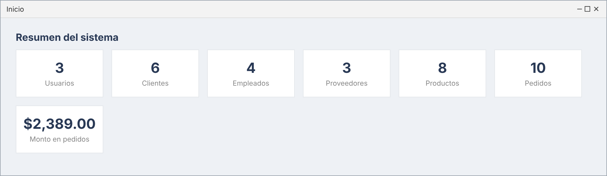

# Parcial II — Herramientas de la Programación Aplicada III (.NET)

Aplicación de escritorio (Windows Forms, C#) que implementa un **inicio de sesión
seguro con hash** y un **panel principal (dashboard) tipo MDI** con menú lateral,
reloj en tiempo real y el usuario que inició sesión. Está construida con el
**patrón MVP** sobre una **arquitectura por capas** y persiste en **MySQL**
usando **procedimientos almacenados** y un usuario de base de datos con
**privilegios mínimos**.

---

## Autor y datos del curso

| Campo | Detalle |
|---|---|
| **Autor** | Mateo Del Giudice |
| **Grupo** | 1IL133 |
| **Asignatura** | Herramientas de la Programación Aplicada III (.NET) |
| **Instructora** | Ing. Irina Fong |
| **Universidad** | Universidad Tecnológica de Panamá (UTP) |
| **Facultad / Campus** | Facultad de Ingeniería en Sistemas Computacionales — Campus Víctor Levi Sasso |
| **Semestre** | II Semestre 2026 |
| **Fecha de entrega** | 09 de noviembre de 2026 |

---

## Tecnologías y versiones

| Tecnología | Versión |
|---|---|
| Lenguaje | C# (LangVersion `latest`) |
| Framework | .NET Framework **4.7.2** |
| Interfaz | Windows Forms (WinForms) |
| Base de datos | MySQL **8.x** |
| Conector | MySQL Connector/NET — `MySql.Data` **8.0.33** (NuGet) |
| IDE | Visual Studio 2022 / 2026 |
| Formato de proyecto | SDK-style (`Microsoft.NET.Sdk`) |
| Hashing | SHA-256 con salt (`System.Security.Cryptography`) |
| Patrón / arquitectura | MVP + arquitectura por capas |

---

## Arquitectura por capas

El proyecto es un único ensamblado organizado en carpetas, una por capa, con
dependencia en un solo sentido: **Vista → Negocio → Datos → Entidades**.

```
Parcial2HPACapas/
├── Entidades/        (Modelos: Usuario, Pedido, ResumenDashboard, ResultadoHash, Sesion)
├── Datos/            (Acceso a MySQL: ConexionBD + repositorios con procedimientos almacenados)
├── Negocio/          (Lógica de negocio y servicios)
│   └── Contratos/    (IHashService, IVerificarHashService — los dos contratos independientes)
└── Vista/            (Patrón MVP)
    ├── Contratos/    (ILoginVista, IDashboardVista, IPedidosVista)
    ├── Presentadores/(LoginPresentador, DashboardPresentador, PedidosPresentador)
    └── Formularios/  (FrmLogin, FrmDashboard [MDI], FrmInicio, FrmPedidos)
```

### Patrón MVP

- **Modelo**: entidades (`Entidades/`) + lógica de negocio y datos (`Negocio/`, `Datos/`).
- **Vista**: formularios *pasivos* que solo exponen datos/eventos e implementan una interfaz de vista.
- **Presentador**: intermediario; escucha a la Vista, pide a Negocio y actualiza la Vista. No conoce al formulario concreto, solo su contrato.

### Los dos contratos independientes (capa de Negocio)

Siguiendo el Principio de Responsabilidad Única, el hashing se divide en **dos
interfaces separadas** en `Negocio/Contratos/`:

- **`IHashService`** → única responsabilidad: **generar** el hash + salt.
- **`IVerificarHashService`** → única responsabilidad: **verificar** una contraseña contra el hash almacenado.

La clase `Sha256HashService` implementa ambos contratos. Gracias al
desacoplamiento, cambiar de SHA-256 a BCrypt/Argon2 solo requiere reemplazar esa
clase, sin tocar Vista, Presentador ni Base de Datos.

> Esquema del hash: `hash = Base64( SHA256( UTF8( salt + contraseña ) ) )`, con un
> `salt` aleatorio de 16 bytes por usuario.

---

## Controles utilizados

`Form` (incluido contenedor **MDI**), `Panel`, `FlowLayoutPanel`, `Label`,
`TextBox` (con `UseSystemPasswordChar`), `Button` (`FlatStyle.Flat`), `CheckBox`
(mostrar/ocultar contraseña), `DataGridView` (listado de pedidos), `Timer`
(reloj en tiempo real) y `MessageBox` (mensajes y confirmaciones).

---

## Requisitos previos

- Windows con Visual Studio 2022/2026 y la carga de trabajo **.NET desktop development**.
- **.NET Framework 4.7.2 Developer Pack**.
- **MySQL Server 8.x** en ejecución (local).
- Conexión a Internet la primera vez (NuGet restaura `MySql.Data`).

---

## Instalación y ejecución

### 1) Crear la base de datos

Ejecuta los scripts de la carpeta [`Database/`](Database) **en orden**, con un
usuario administrador de MySQL (p. ej. `root`), desde MySQL Workbench o la
consola `mysql`:

| # | Archivo | Para qué sirve |
|---|---|---|
| 01 | `01_crear_base_datos.sql` | Crea la base de datos `parcial2_hpa`. |
| 02 | `02_crear_tablas.sql` | Crea las tablas (usuarios, clientes, empleados, proveedores, productos, pedidos). |
| 03 | `03_procedimientos_almacenados.sql` | Crea los procedimientos almacenados (login, registro, resumen, pedidos). |
| 04 | `04_datos_iniciales_mock.sql` | Carga datos de prueba (incluye usuarios con hash/salt). |
| 05 | `05_crear_usuario_privilegios_minimos.sql` | Crea el usuario de BD `app_hpa` con **solo** permiso `EXECUTE`. |

Ejemplo por consola:

```bash
mysql -u root -p < Database/01_crear_base_datos.sql
mysql -u root -p < Database/02_crear_tablas.sql
mysql -u root -p < Database/03_procedimientos_almacenados.sql
mysql -u root -p < Database/04_datos_iniciales_mock.sql
mysql -u root -p < Database/05_crear_usuario_privilegios_minimos.sql
```

### 2) Configurar la cadena de conexión

En `Parcial2HPACapas/App.config` ajusta `Server`, `Port` y, si cambiaste la
clave, `Pwd`. Por defecto apunta al usuario de **privilegios mínimos**:

```xml
<add name="ConexionMySql"
     connectionString="Server=localhost;Port=3306;Database=parcial2_hpa;Uid=app_hpa;Pwd=AppHpa2026!;SslMode=Preferred;AllowPublicKeyRetrieval=true;"
     providerName="MySql.Data.MySqlClient" />
```

### 3) Compilar y ejecutar

1. Abre `Parcial2HPACapas.slnx` en Visual Studio.
2. Restaura los paquetes NuGet (automático al compilar).
3. Presiona **F5**.

### Credenciales de prueba

| Correo | Contraseña | Rol |
|---|---|---|
| `admin@utp.ac.pa` | `Admin123*` | Administrador |
| `usuario@utp.ac.pa` | `Usuario123*` | Usuario |
| `invitado@utp.ac.pa` | `Invitado123*` | Invitado |

---

## Seguridad: conexión con privilegios mínimos

La aplicación **no** se conecta como `root`. El usuario `app_hpa` tiene
únicamente permiso `EXECUTE` sobre los procedimientos almacenados y **ningún**
acceso directo (SELECT/INSERT/UPDATE/DELETE) a las tablas. Como los
procedimientos se definen con `SQL SECURITY DEFINER`, se ejecutan con los
permisos del creador, de modo que la cuenta de la aplicación opera con el mínimo
privilegio posible.

---

## Resultados (capturas)

### Inicio de sesión


### Validaciones


### Ventana principal MDI (menú lateral + reloj + usuario)


### Módulo de Pedidos (dentro del MDI)


### Tarjetas de resumen


---

## Cómo cumple la rúbrica

| Criterio de la rúbrica | Dónde se implementa |
|---|---|
| Patrón de Diseño MVP | `Vista/Contratos` + `Vista/Presentadores` + formularios pasivos |
| Dos contratos independientes (Hash / Verificar) | `Negocio/Contratos/IHashService.cs`, `IVerificarHashService.cs` |
| Generar y verificar Hash | `Negocio/Sha256HashService.cs` |
| Conexión con privilegios mínimos | `Database/05_...sql` + `App.config` (usuario `app_hpa`) |
| Menú lateral + hora actual | `FrmDashboard` (`pnlLateral`, `timerReloj`, `lblReloj`) |
| Usuario que inició sesión (parte inferior) | `FrmDashboard` → `pnlUsuario` (`lblNombreUsuario`, `lblRolUsuario`) |
| Repositorio (código fuente) | Todo el proyecto, versionado con Git |
| Documentación del código | Comentarios XML (`///`) en todas las clases y métodos |
| README.md | Este archivo |

---

## Notas de diseño

- El proyecto se convirtió a formato **SDK-style** para que NuGet restaure el
  conector MySQL automáticamente y los archivos se incluyan sin editar el
  `.csproj` a mano.
- El tablero (`FrmInicio`) y `FrmPedidos` se abren como **formularios hijos MDI**
  dentro de `FrmDashboard`.
